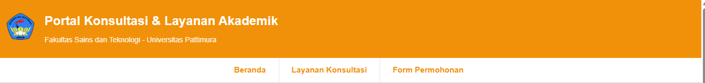
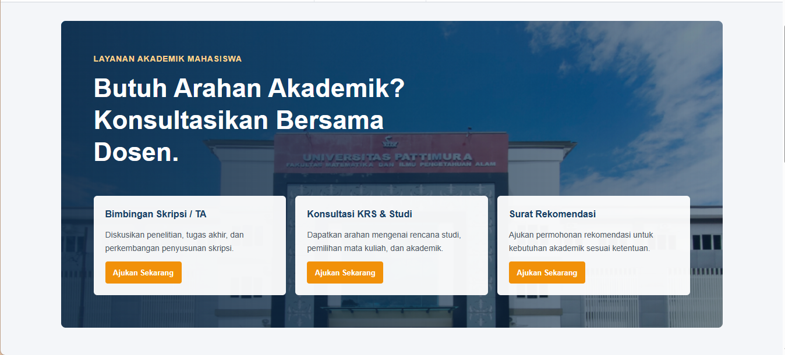
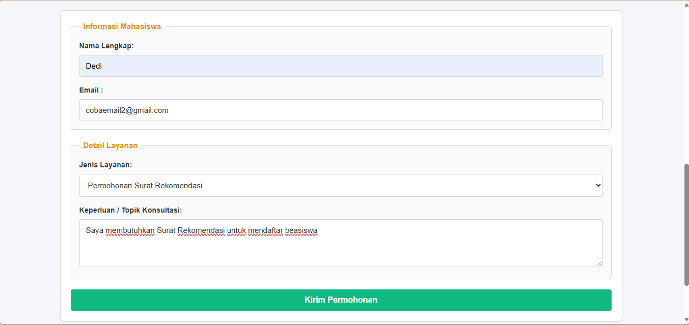
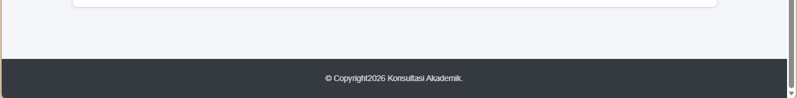

# Portal Konsultasi & Layanan Akademik Dosen

Website portal layanan akademik yang memudahkan mahasiswa untuk mengajukan konsultasi kepada dosen.

## Fitur Website

- Navigasi halaman (Navbar)
- Section informasi layanan akademik
- Formulir permohonan konsultasi
- Footer sebagai bagian penutup website
- Tampilan responsif untuk perangkat desktop dan mobile

## Tampilan Website

### 1. Navigation Bar

### 2. Section Utama

### 3. Formulir Permohonan

### 4. Footer

## Teknologi

- HTML5
- CSS3
- JavaScript

## Tujuan

Proyek ini dibuat untuk menyelesaikan tugas mata kuliah pemrograman berbasis platform dengan menerapkan konsep dasar pengembangan website, meliputi struktur HTML semantic, desain antarmuka menggunakan CSS, dan interaktivitas menggunakan JavaScript.
